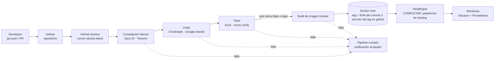
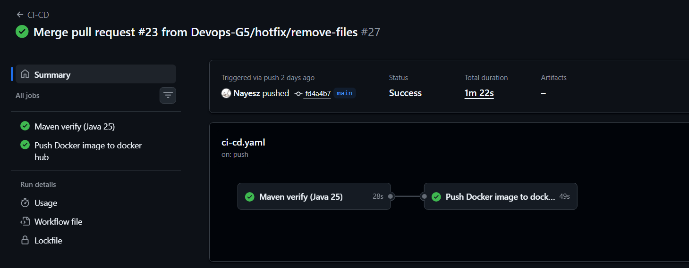
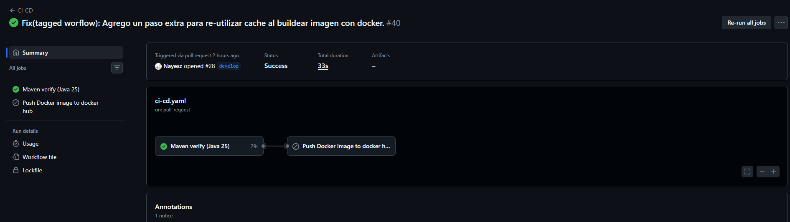
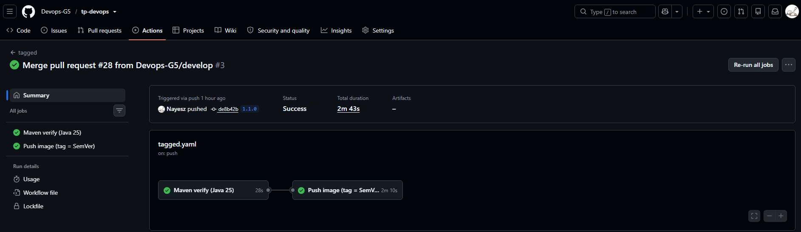
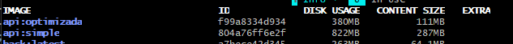
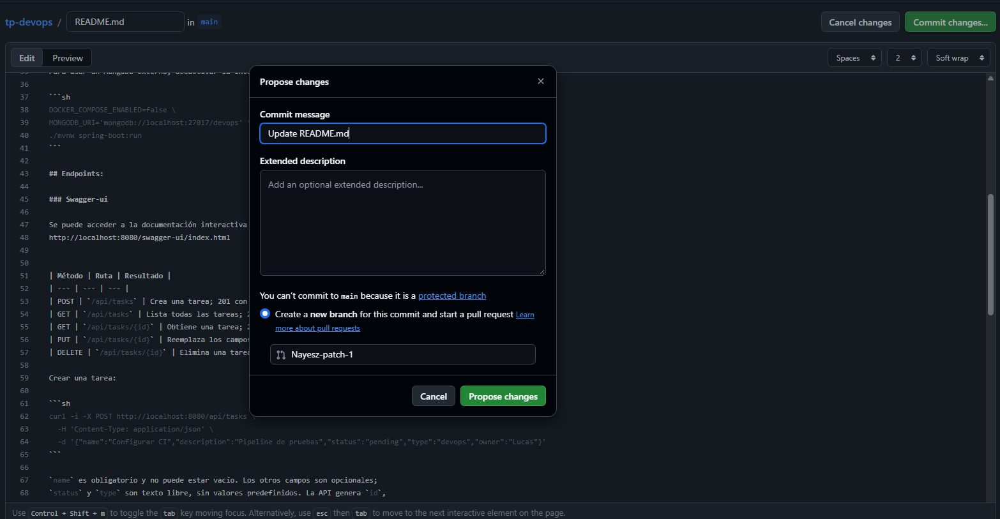
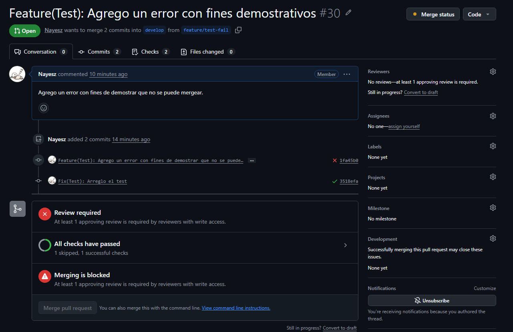
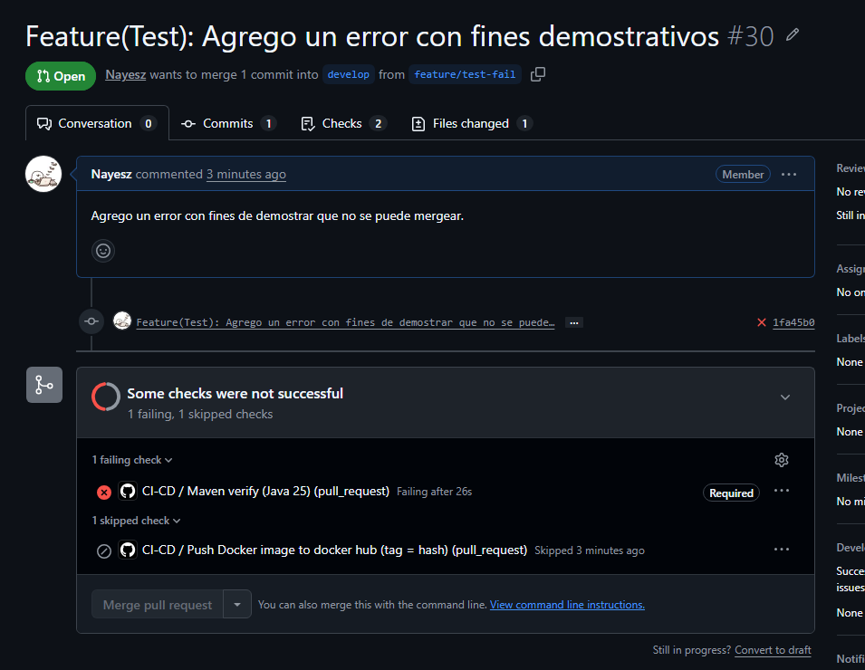
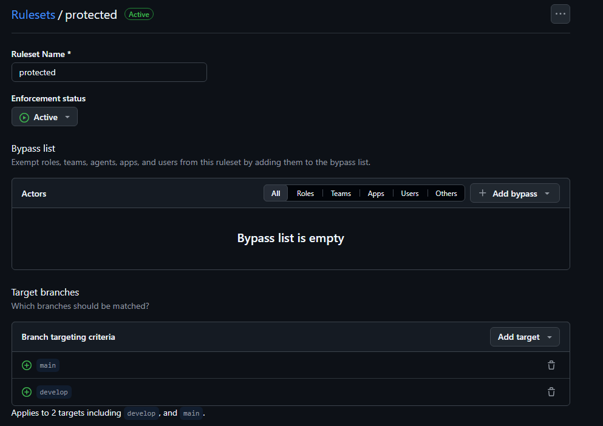

# Informe Técnico

- **Proyecto:** Devops-app
- **Integrantes:** Lucas Bonaffini,Nayla Zárate
- **Materia:** DevOps

---

## Índice

1. [Arquitectura del Pipeline](#1-arquitectura-del-pipeline)
2. [Justificación Técnica y Decisiones de Diseño](#2-justificación-técnica-y-decisiones-de-diseño)
3. [Aplicación de la Filosofía DevOps](#3-aplicación-de-la-filosofía-devops)
4. [Principios Lean (Reducción de Desperdicio)](#4-principios-lean-reducción-de-desperdicio)
5. [Conclusiones](#5-conclusiones)

---

## 1. Arquitectura del Pipeline

### 1.1 Diagrama de flujo

Ciclo de vida del código desde el `git push` hasta la publicación del artefacto o el despliegue.


# TODO: ver si haecemos cd

### 1.2 Componentes del flujo

| Etapa | Herramienta | Función |
|---|---|---|
| Control de versiones | GitHub | Almacena el código y dispara el pipeline (push ó PR a `main`/`develop`, ejecución manual y cuando se crea un tag) |
| Build | Maven (`mvnw`) + Java 25 (Temurin) | Compila el proyecto Spring Boot 4.1.1 |
| Linter | Checkstyle 14.1.0 (reglas `google_checks.xml`) | Verifica estilo; `failOnViolation=true` corta el build si hay violaciones |
| Tests | JUnit / starters de test de Spring Boot | Valida el comportamiento de la aplicación (`mvn verify`) |
| Runner de CI | GitHub Actions (`ubuntu-latest`) | Ejecuta las etapas del pipeline en un entorno efímero |
| Construcción de imagen | Docker + `docker/build-push-action` | Genera la imagen del contenedor |
| Registro de imágenes | Docker Hub | Almacena y versiona los artefactos (tag = SHA del commit ó semVer del tag en github) |
| Hosting / Despliegue | [COMPLETAR: Render / Railway / Fly.io / VPS / otro] | Ejecuta la aplicación en producción |
| Monitoreo | Spring Boot Actuator + Micrometer (Prometheus) + Grafana  | Expone métricas y salud de la API |


### 1.3 El workflow 'ci-cd'

Se puede consultar el archivo yaml con todos los pasos [acá](../.github/workflows/ci-cd.yaml)

**Puntos clave del workflow:**

- `./mvnw verify` ejecuta en una sola orden la compilación, Checkstyle (fase `verify`) y los tests.
- `needs: build-and-test` garantiza que **no se publica ninguna imagen si falló el lint o un test**.
- `if: github.ref == 'refs/heads/main'` limita la publicación a la rama principal.
- Las credenciales de Docker Hub se guardan como **secrets** (`DOCKERHUB_USERNAME`, `DOCKERHUB_TOKEN`), nunca en el código.
- La imagen se etiqueta con el **SHA del commit**, lo que da trazabilidad exacta entre código y artefacto.
- Se usa caché de Maven (`cache: maven`) para acelerar las ejecuciones (feedback más rápido).

>Pipeline ejecutado (rama main)


vs.

>Pipeline ejecutado (rama develop)


---


### 1.4 El workflow 'tagged'


Se puede consultar el archivo yaml con todos los pasos [acá](../.github/workflows/tagged.yaml)

Este workflow se encarga de **publicar versiones**: se dispara únicamente cuando se sube un tag con formato SemVer (por ejemplo `1.1.0`) y publica en Docker Hub una imagen con esa versión exacta.

```bash
git tag 1.1.0
git push origin 1.1.0
```

**Puntos clave del workflow:**

- `on.push.tags: '[0-9]+.[0-9]+.[0-9]+'` hace que el workflow solo se ejecute con tags en formato `X.Y.Z`. Cualquier otro tag (`hola`, `1.1`) ni siquiera lo dispara.
- Antes de publicar vuelve a ejecutar `./mvnw verify` (compilación, Checkstyle y tests), y `needs: build-and-test` garantiza que **no se publica ninguna versión si falló el lint o un test**.
- `docker/metadata-action` con `type=semver,pattern={{version}}` genera el tag de la imagen a partir del tag de Git: el tag `1.1.0` produce la imagen `usuario/imagen:1.1.0`.
- `flavor: latest=false` evita el tag `latest`, de modo que cada versión es un tag **fijo e inmutable**, útil para despliegues y rollbacks.
- El paso **Validar version** funciona como una segunda barrera (Andon Cord): si no se generó ningún tag de imagen o el nombre del tag no cumple `X.Y.Z`, el workflow falla con `exit 1` y los pasos siguientes (login, build y push) **no se ejecutan**.
- La versión se pasa al Dockerfile mediante `APP_VERSION`, que queda registrada en la etiqueta `org.opencontainers.image.version` de la imagen, lo que da trazabilidad entre el código, el tag y el artefacto.
- Las credenciales de Docker Hub se guardan como **secrets** (`DOCKERHUB_USERNAME`, `DOCKERHUB_TOKEN`), nunca en el código.
- `docker/setup-buildx-action` y `cache-from/cache-to: type=gha` reutilizan las capas de Docker entre ejecuciones, lo que acelera el build.

> Pipeline ejecutado (tag SemVer)



**Diferencia con `ci-cd`:**

| | `ci-cd` | `tagged` |
|---|---|---|
| Disparador | push y PR a `main` / `develop` | push de un tag `X.Y.Z` |
| Tag de la imagen | SHA del commit | Versión SemVer (`1.1.0`) |
| Uso | Integración continua y artefacto de cada cambio en `main` | Versiones liberadas e identificables |

---

## 2. Justificación Técnica y Decisiones de Diseño

### 2.1 Optimización de contenedores

#### Dockerfile utilizado

```dockerfile
ARG TAG_VERSION_BUILD=3.9-eclipse-temurin-25-alpine
ARG TAG_VERSION=25-jre-alpine

# STAGE 1 - BUILD
FROM maven:${TAG_VERSION_BUILD} AS build

WORKDIR /app

COPY pom.xml .


RUN mvn dependency:go-offline

COPY src ./src

RUN mvn clean package -DskipTests

FROM eclipse-temurin:${TAG_VERSION} AS prd

ARG APP_VERSION
ARG BUILD_DATE

LABEL org.opencontainers.image.created=$BUILD_DATE \
      org.opencontainers.image.version=$APP_VERSION \
      maintainer="Nayesz;Lucasb" \
      description="DevOps Project 2026 - G5"

WORKDIR /app

RUN addgroup -S appgroup && adduser -S appuser -G appgroup  # Se crea usuario no-root
USER appuser

COPY --from=build --chown=appuser:appuser /app/target/*.jar app.jar

EXPOSE 8080

ENTRYPOINT ["java", "-jar", "/app/app.jar"]
```

#### Justificación de decisiones

| Decisión | Elección | Justificación |
|---|---|---|
| **Imagen base** | Build: `maven:3.9-eclipse-temurin-25-alpine`. Runtime: `eclipse-temurin:25-jre-alpine` | Basadas en **Alpine**: mucho más livianas que las imágenes Debian/Ubuntu, con menor superficie de ataque. En runtime se usa solo el **JRE** (sin JDK ni Maven), ya que para ejecutar el `.jar` no hace falta compilar. Temurin es una distribución OpenJDK abierta y mantenida. |
| **Versiones parametrizadas** | `ARG TAG_VERSION_BUILD` y `ARG TAG_VERSION` | Los tags de las imágenes base se definen en un solo lugar al inicio, lo que facilita actualizar la versión de Java sin tocar el resto del archivo. |
| **Estrategia de capas** | `COPY pom.xml` → `mvn dependency:go-offline` → `COPY src` → `mvn package` | Se ordena de lo que menos cambia a lo que más cambia. Si solo se modifica el código, Docker reutiliza la capa de dependencias (la más lenta) y no las vuelve a descargar. Acelera el build. |
| **Multi-stage build** | Etapa `build` (JDK + Maven) y etapa `prd` (JRE) | La imagen final contiene solo el JRE y el `.jar` (`COPY --from=build`); no incluye Maven, el código fuente ni el caché de dependencias. Resultado: imagen más chica y más segura. |
| **Usuario no-root** | `addgroup -S appgroup && adduser -S appuser -G appgroup` + `USER appuser` | Usuario y grupo de sistema sin privilegios para ejecutar la aplicación. Si el contenedor es vulnerado, el atacante no tiene privilegios de root (principio de mínimo privilegio). El `.jar` se copia con `--chown=appuser:appuser`. |
| **`-DskipTests` en el build** | `mvn clean package -DskipTests` | Los tests ya se ejecutaron en el job de CI (`mvnw verify`) antes de construir la imagen; repetirlos en el Dockerfile solo alargaría el build. |
| **Metadatos OCI** | `LABEL org.opencontainers.image.created / version`, `maintainer`, `description` | Trazabilidad: la imagen publicada indica cuándo y desde qué versión se construyó (valores recibidos por `build-args` desde el workflow). |

#### Comparación de tamaño de imagen

| Versión del Dockerfile | Tamaño de la imagen |
|---|---|
| Sin optimizar (una sola etapa, imagen `maven` con JDK, sin Alpine) | [COMPLETAR: medir con `docker images`] |
| Optimizada (Alpine + JRE + multi-stage) | [COMPLETAR: medir con `docker images`] |

Para tener el dato real: construimos ambas versiones localmente `api:optimizada` y una variante de una sola etapa `api:simple` con el siguiente Dockerfile:

```dockerfile
ARG TAG_VERSION_BUILD=3.9-eclipse-temurin-25-alpine

FROM maven:${TAG_VERSION_BUILD}

ARG APP_VERSION
ARG BUILD_DATE

LABEL org.opencontainers.image.created=$BUILD_DATE \
      org.opencontainers.image.version=$APP_VERSION \
      maintainer="Nayesz;Lucasb" \
      description="DevOps Project 2026 - G5"

WORKDIR /app

# Se crea un usuario no-root
RUN addgroup -S appgroup && adduser -S appuser -G appgroup

# Primero copiamos el POM para aprovechar la caché de dependencias
COPY pom.xml .

RUN mvn dependency:go-offline

# Copiamos el código fuente
COPY src ./src

# Compilamos y generamos el JAR
RUN mvn clean package -DskipTests

# Ejecutamos la aplicación como usuario no-root
USER appuser

EXPOSE 8080

ENTRYPOINT ["java", "-jar", "/app/target/tu-aplicacion.jar"]

```

Esta es la comparacion de las imagenes donde podemos ver la diferencia del peso en la imagen final:
> 

### 2.2 Estrategia de integración

#### Modelo de branching elegido: GitFlow (`main` + `develop` + ramas de trabajo)

**Reglas adoptadas:**

- `main`: rama estable; desde ella se publica una imagen en Docker Hub tagueada con el hash del commit.
- `develop`: rama de integración donde se juntan las funcionalidades.
- Ramas de trabajo: `feature/*`, `fix/*` de vida corta, que parten de `develop`.
- Todo cambio entra a `develop` o `main` mediante Pull Request.
- Convención de commits: Conventional Commits.
- Estrategia de merge:  merge commit, mantenemos todos los commits del PR y se agrega un commit de merge.
**Justificación:** Elegimos GitFlow en primer lugar porque es lo conocido. Además, creemos que GitFlow tiene más armonia con el código en sus distintas etapas,
'lo estable' -> main, 'lo que se integro de distintas ramas de trabajo y esta estable pero todavía no fue a prd' -> develop , multiples ramas según de que se trate feature/, fix/,
etc. Además hace más fácil definir las reglas para el workflow de github actions, ya que podes tener distintas acciones para c/u.

#### Protección de ramas (`main`)

Configuración aplicada en **Settings → Branches → Branch protection rules**:

- Requerir Pull Request antes de hacer merge:

- Requerir al menos 1 aprobación de revisión:

- Requerir que los checks de CI pasen (lint, tests, build) antes del merge:

- Bloquear push directo y force-push a `main`


Configuración de protección de ramas sobre main y develop:



---

## 3. Aplicación de la Filosofía DevOps

### 3.1 Primera Forma: Flujo y Consistencia

#### ¿Qué tareas manuales quedaron 100% automatizadas?

| Tarea manual (antes) | Automatización (ahora) |
|---|---|
| Ejecutar el linter localmente "cuando uno se acuerda" | El linter corre en cada push/PR |
| Correr los tests a mano antes de entregar | Los tests se ejecutan automáticamente en el runner |
| Construir la imagen Docker en la máquina del desarrollador | El build ocurre en CI con un entorno limpio |
| Etiquetar y subir la imagen al registro manualmente | El pipeline la etiqueta (`sha` / versión) y la publica |

#### ¿Cómo se asegura que el entorno sea idéntico en desarrollo y CI/CD?

- **Misma imagen, mismo Dockerfile:** el contenedor que se prueba en CI es el mismo artefacto que se despliega (*build once, run anywhere*).
- **Versiones fijadas:** imagen base con tag explícito (ej. `python:3.12-slim`) y dependencias con versiones pinneadas (`requirements.txt` / lockfile).
- **Docker Compose** para desarrollo local que replica el entorno del contenedor: [COMPLETAR: `docker-compose.yml`].
- **Configuración por variables de entorno** (12-Factor App): el código no cambia entre entornos, solo la configuración.
- **Runner efímero:** cada ejecución de CI parte de un entorno limpio, sin estado residual.

> **📷 Imagen sugerida:** captura del `docker-compose up` local junto al log del job de CI usando la misma imagen.

### 3.2 Segunda Forma: Feedback Rápido y Andon Cord

#### Interrupción del pipeline: puntos donde se "corta el cable"

| Etapa | Condición de falla | Efecto |
|---|---|---|
| **Compilación (Maven)** | Error de compilación | `mvn verify` falla; el job termina en rojo |
| **Linter (Checkstyle)** | Cualquier violación de las reglas de Google (`failOnViolation=true`) | Falla el job `build-and-test`; no se publica imagen |
| **Tests (JUnit)** | Al menos un test falla | Falla el job `build-and-test` y se bloquea el merge del PR |
| **Dependencia entre jobs** | `needs: build-and-test` no se cumplió | El job de Docker Hub **no se ejecuta** |
| **Build de imagen Docker** | Error de construcción | No se publica el artefacto |
| **Protección de rama** | Checks requeridos en rojo | GitHub impide el merge a `main` [COMPLETAR: confirmar que está configurada] |

**Principio:** un artefacto defectuoso nunca llega al registro ni a producción. El equipo recibe la notificación por [COMPLETAR: email / Slack / Discord / GitHub] y la prioridad es **arreglar el pipeline antes de seguir produciendo código nuevo**.

> **📷 Imagen sugerida:** captura de un pipeline en rojo con el paso que falló resaltado.
>
> ``

#### Visibilidad de fallos: errores HTTP 5xx y latencia alta

| Aspecto | Detalle |
|---|---|
| **Herramienta de monitoreo** | Spring Boot Actuator + Micrometer, con métricas en formato Prometheus [COMPLETAR: Prometheus + Grafana u otra herramienta que consuma `/actuator/prometheus`] |
| **Señal para 5xx** | **Métrica:** `http_server_requests_seconds_count{status=~"5.."}` (tasa de errores). **Log:** trazas de excepciones en stdout del contenedor. |
| **Señal para latencia** | **Métrica:** `http_server_requests_seconds_*` (duración de requests; percentiles p95/p99 si se habilita el histograma). |
| **Disponibilidad** | Endpoint de salud `/actuator/health` (usable como healthcheck del contenedor o probe externo). |
| **Alerta** | Se dispara si [COMPLETAR: ej. tasa de 5xx > 5% durante 5 min, o p95 > 1 s durante 5 min] |
| **Canal de notificación** | [COMPLETAR: email / Slack / Discord / Telegram] |

Ejemplo de regla de alerta (Prometheus):

```yaml
# Ejemplo referencial
groups:
  - name: api-alerts
    rules:
      - alert: AltaTasaErrores5xx
        expr: sum(rate(http_requests_total{status=~"5.."}[5m]))
              / sum(rate(http_requests_total[5m])) > 0.05
        for: 5m
        labels:
          severity: critical
        annotations:
          summary: "Más del 5% de respuestas 5xx en los últimos 5 minutos"
```

> **📷 Imagen sugerida:** dashboard de Grafana (o la herramienta usada) mostrando tasa de errores y latencia, y la alerta recibida.
>
> ``

### 3.3 Tercera Forma: Aprendizaje y Simulación de Fallos

#### Experimento de falla controlada

**Escenario:** [COMPLETAR: elegir uno]

- *Opción A:* se modificó un test unitario (o el código) para que fallara intencionalmente.
- *Opción B:* se eliminó una variable de entorno obligatoria (ej. `DATABASE_URL`).
- *Opción C:* se introdujo un error que devuelve HTTP 500 en un endpoint.

**Hipótesis:** [COMPLETAR: ej. "el pipeline debería detener el flujo en la etapa de tests y bloquear el merge"].

**Procedimiento:**

1. [COMPLETAR: ej. Se creó la rama `experiment/fallo-controlado`.]
2. [COMPLETAR: ej. Se rompió el endpoint `/items` para que lance una excepción.]
3. [COMPLETAR: ej. Se hizo push y se abrió un Pull Request hacia `main`.]

**Resultado observado:**

| Momento | Qué ocurrió |
|---|---|
| T+0 | Push de la rama con el defecto |
| T+[COMPLETAR] min | El job de [COMPLETAR: tests] falló |
| T+[COMPLETAR] min | Se envió la notificación a [COMPLETAR] |
| — | El PR quedó bloqueado; no se publicó ninguna imagen |

> **📷 Imágenes sugeridas:** (1) log del test fallido, (2) PR bloqueado con checks en rojo, (3) notificación/alerta recibida.
>
> ``
> ``

**Aprendizaje obtenido:** [COMPLETAR: ej. se detectó el error en N minutos en lugar de en producción; se agregó un test de regresión / validación de variables de entorno al arranque para fallar rápido con un mensaje claro].

**Mejoras incorporadas tras el experimento:**

- [COMPLETAR: ej. validación de variables de entorno al iniciar la app]
- [COMPLETAR: ej. nuevo test que cubre el caso]
- [COMPLETAR: ej. ajuste del umbral de alerta]

---

## 4. Principios Lean (Reducción de Desperdicio)

| # | Desperdicio común | Cómo se manifiesta | Cómo lo evita la solución implementada |
|---|---|---|---|
| 1 | **Esperas** (compilación, empaquetado y despliegue manuales) | El equipo espera a que alguien construya y suba la versión | El pipeline construye, prueba y publica automáticamente en cada cambio; la caché de capas de Docker acorta los tiempos de build |
| 2 | **Defectos detectados tarde** (bugs en producción) | Un error llega a los usuarios y su corrección es costosa | Linter y tests en CI detectan el defecto en minutos; la protección de ramas impide integrar código roto |
| 3 | **Reprocesos y configuración manual** ("en mi máquina funciona") | Se pierde tiempo replicando entornos y corrigiendo diferencias | Contenedor idéntico en todos los entornos; infraestructura y configuración como código |
| 4 | *(Opcional)* **Sobreproducción / código sin integrar** | Ramas largas con cambios acumulados y conflictos | Ramas de vida corta y PRs pequeños con integración frecuente |

**Mejora medible:** [COMPLETAR: ej. el tiempo desde el commit hasta el despliegue pasó de ~[X] min manuales a ~[Y] min automáticos].

---

## 5. Conclusiones

- [COMPLETAR: beneficios principales observados al automatizar el ciclo de vida]
- [COMPLETAR: dificultades encontradas y cómo se resolvieron]
- [COMPLETAR: mejoras futuras, ej. despliegue continuo con rollback automático, análisis de cobertura, pruebas de carga, entornos de staging]

---

## Anexos

- **Anexo A:** `Dockerfile` completo
- **Anexo B:** Workflow de CI completo (`.github/workflows/*.yml`)
- **Anexo C:** Configuración de monitoreo y alertas
- **Anexo D:** Enlaces — repositorio, registro de imágenes, aplicación desplegada, dashboards

---

### Checklist de imágenes para el informe y la exposición

- [ ] Diagrama de flujo del pipeline
- [ ] Pipeline ejecutado con todas las etapas en verde
- [ ] Comparación de tamaño de imagen Docker
- [ ] Configuración de protección de ramas
- [ ] Pipeline fallido (Andon Cord)
- [ ] Dashboard de monitoreo / alertas
- [ ] Evidencia del experimento de falla controlada