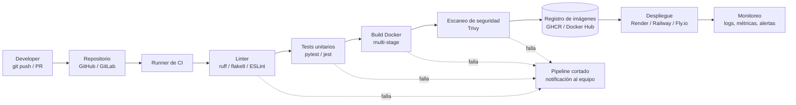

# Informe Técnico: Pipeline CI/CD y Filosofía DevOps

**Proyecto:** [COMPLETAR: nombre del proyecto / API]
**Integrantes:** [COMPLETAR]
**Materia / Cátedra:** [COMPLETAR]
**Fecha:** [COMPLETAR]
**Repositorio:** [COMPLETAR: URL]

> Las secciones marcadas con `[COMPLETAR]` deben adaptarse a las herramientas reales que usó el equipo. Los bloques de ejemplo (YAML, Dockerfile, etc.) son referenciales: reemplazalos por los de tu repositorio.

---

## Índice

1. [Arquitectura del Pipeline](#1-arquitectura-del-pipeline)
2. [Justificación Técnica y Decisiones de Diseño](#2-justificación-técnica-y-decisiones-de-diseño)
3. [Aplicación de la Filosofía DevOps](#3-aplicación-de-la-filosofía-devops)
4. [Principios Lean (Reducción de Desperdicio)](#4-principios-lean-reducción-de-desperdicio)
5. [Conclusiones](#5-conclusiones)

---

## 1. Arquitectura del Pipeline

### 1.1 Diagrama de flujo

Ciclo de vida del código desde el `git push` hasta la publicación del artefacto o el despliegue.



> **📷 Imagen sugerida:** exportar el diagrama anterior (por ejemplo desde [mermaid.live](https://mermaid.live)) o rehacerlo en draw.io / Excalidraw para insertarlo en la presentación.
>
> ``

### 1.2 Componentes del flujo

| Etapa | Herramienta | Función |
|---|---|---|
| Control de versiones | [COMPLETAR: GitHub / GitLab] | Almacena el código y dispara el pipeline |
| Linter | [COMPLETAR: ruff, flake8, ESLint, etc.] | Verifica estilo y errores estáticos |
| Tests | [COMPLETAR: pytest, jest, etc.] | Valida el comportamiento de la aplicación |
| Runner de CI | [COMPLETAR: GitHub Actions / GitLab CI] | Ejecuta las etapas del pipeline |
| Construcción | Docker / Buildx | Genera la imagen del contenedor |
| Escaneo de seguridad | [COMPLETAR: Trivy / Snyk] (opcional) | Detecta vulnerabilidades en la imagen |
| Registro de imágenes | [COMPLETAR: GHCR / Docker Hub] | Almacena y versiona los artefactos |
| Hosting / Despliegue | [COMPLETAR: Render / Railway / Fly.io / VPS] | Ejecuta la aplicación en producción |
| Monitoreo | [COMPLETAR: Prometheus + Grafana / UptimeRobot / Sentry] | Detecta fallos y degradación |

> **📷 Imagen sugerida:** captura de pantalla del workflow ejecutándose con todas las etapas en verde.
>
> ``

### 1.3 Ejemplo del workflow de CI

```yaml
# .github/workflows/ci.yml  (ejemplo; reemplazar por el real)
name: CI

on:
  push:
    branches: [main]
  pull_request:
    branches: [main]

jobs:
  build-test:
    runs-on: ubuntu-latest
    steps:
      - uses: actions/checkout@v4
      - name: Lint
        run: [COMPLETAR: comando del linter]
      - name: Tests
        run: [COMPLETAR: comando de tests]
      - name: Build de imagen
        run: docker build -t mi-api:${{ github.sha }} .
      - name: Login y push al registro
        if: github.ref == 'refs/heads/main'
        run: [COMPLETAR]
```

---

## 2. Justificación Técnica y Decisiones de Diseño

### 2.1 Optimización de contenedores

#### Dockerfile utilizado

```dockerfile
# Ejemplo (Python). Reemplazar por el Dockerfile real del proyecto.

# ---------- Etapa 1: build ----------
FROM python:3.12-slim AS builder
WORKDIR /app
COPY requirements.txt .
RUN pip install --no-cache-dir --prefix=/install -r requirements.txt

# ---------- Etapa 2: runtime ----------
FROM python:3.12-slim AS runtime
WORKDIR /app

# Usuario no-root
RUN useradd --create-home --shell /usr/sbin/nologin appuser

COPY --from=builder /install /usr/local
COPY --chown=appuser:appuser . .

USER appuser
EXPOSE 8000

HEALTHCHECK --interval=30s --timeout=3s \
  CMD python -c "import urllib.request; urllib.request.urlopen('http://localhost:8000/health')" || exit 1

CMD ["uvicorn", "main:app", "--host", "0.0.0.0", "--port", "8000"]
```

#### Justificación de decisiones

| Decisión | Elección | Justificación |
|---|---|---|
| **Imagen base** | [COMPLETAR: ej. `python:3.12-slim` / `alpine`] | Menor tamaño y menor superficie de ataque que una imagen completa; `slim` evita problemas de compatibilidad de `musl` que puede traer `alpine`. |
| **Estrategia de capas** | Copiar primero las dependencias (`requirements.txt`) y luego el código | Aprovecha la caché de Docker: si el código cambia pero las dependencias no, no se reinstalan. Acelera el build. |
| **Multi-stage build** | Etapa `builder` + etapa `runtime` | La imagen final no incluye compiladores ni herramientas de build; es más liviana y segura. |
| **Usuario no-root** | `USER appuser` | Si el contenedor es vulnerado, el atacante no tiene privilegios de root dentro del contenedor (principio de mínimo privilegio). |
| **`.dockerignore`** | Excluye `.git`, `__pycache__`, `.env`, tests | Reduce el contexto de build y evita filtrar secretos. |
| **Healthcheck** | Endpoint `/health` | Permite que la plataforma detecte contenedores no saludables y los reinicie. |

#### Comparación de tamaño de imagen

| Versión del Dockerfile | Tamaño de la imagen |
|---|---|
| Sin optimizar (imagen completa, una sola etapa) | [COMPLETAR: ej. 1.1 GB] |
| Optimizada (slim + multi-stage) | [COMPLETAR: ej. 180 MB] |

> **📷 Imagen sugerida:** salida de `docker images` mostrando ambos tamaños, o un gráfico de barras comparativo.
>
> ``

### 2.2 Estrategia de integración

#### Modelo de branching elegido: [COMPLETAR: Trunk-Based / GitFlow / GitHub Flow]

**Reglas adoptadas:**

- Rama principal: `main` (siempre desplegable).
- Ramas de trabajo: `feature/*`, `fix/*` de vida corta (idealmente menos de 1–2 días).
- Todo cambio entra a `main` mediante Pull Request.
- Convención de commits: [COMPLETAR: ej. Conventional Commits].
- Estrategia de merge: [COMPLETAR: squash / merge commit / rebase].

**Justificación:** [COMPLETAR: ej. Trunk-Based reduce conflictos de integración, favorece la integración continua real y acorta el tiempo entre commit y producción, algo adecuado para un equipo pequeño].

| Criterio | Trunk-Based | GitFlow |
|---|---|---|
| Complejidad | Baja | Alta (develop, release, hotfix) |
| Frecuencia de integración | Alta | Media/Baja |
| Adecuado para CD | Sí | Requiere más ceremonia |
| Equipo pequeño | Muy adecuado | Excesivo |

#### Protección de ramas (`main`)

Configuración aplicada en **Settings → Branches → Branch protection rules**:

- [x] Requerir Pull Request antes de hacer merge
- [x] Requerir al menos [COMPLETAR: 1] aprobación de revisión
- [x] Requerir que los checks de CI pasen (lint, tests, build) antes del merge
- [x] Requerir que la rama esté actualizada con `main`
- [x] Bloquear push directo y force-push a `main`
- [ ] [COMPLETAR: otras reglas, ej. historial lineal, resolver conversaciones]

> **📷 Imagen sugerida:** captura de la configuración de protección de ramas y de un PR bloqueado por checks fallidos.
>
> ``

---

## 3. Aplicación de la Filosofía DevOps

### 3.1 Primera Forma: Flujo y Consistencia

#### ¿Qué tareas manuales quedaron 100% automatizadas?

| Tarea manual (antes) | Automatización (ahora) |
|---|---|
| Ejecutar el linter localmente "cuando uno se acuerda" | El linter corre en cada push/PR |
| Correr los tests a mano antes de entregar | Los tests se ejecutan automáticamente en el runner |
| Construir la imagen Docker en la máquina del desarrollador | El build ocurre en CI con un entorno limpio |
| Etiquetar y subir la imagen al registro manualmente | El pipeline la etiqueta (`sha` / versión) y la publica |
| Desplegar copiando archivos o por SSH | Despliegue automático desde la imagen publicada [COMPLETAR] |
| Verificar vulnerabilidades a ojo | Escaneo automático de la imagen [COMPLETAR si aplica] |

#### ¿Cómo se asegura que el entorno sea idéntico en desarrollo y CI/CD?

- **Misma imagen, mismo Dockerfile:** el contenedor que se prueba en CI es el mismo artefacto que se despliega (*build once, run anywhere*).
- **Versiones fijadas:** imagen base con tag explícito (ej. `python:3.12-slim`) y dependencias con versiones pinneadas (`requirements.txt` / lockfile).
- **Docker Compose** para desarrollo local que replica el entorno del contenedor: [COMPLETAR: `docker-compose.yml`].
- **Configuración por variables de entorno** (12-Factor App): el código no cambia entre entornos, solo la configuración.
- **Runner efímero:** cada ejecución de CI parte de un entorno limpio, sin estado residual.

> **📷 Imagen sugerida:** captura del `docker-compose up` local junto al log del job de CI usando la misma imagen.

### 3.2 Segunda Forma: Feedback Rápido y Andon Cord

#### Interrupción del pipeline: puntos donde se "corta el cable"

| Etapa | Condición de falla | Efecto |
|---|---|---|
| **Linter** | Errores de estilo o análisis estático | El pipeline se detiene; no se ejecutan tests ni build |
| **Tests unitarios** | Al menos un test falla (o cobertura < [COMPLETAR]%) | Se bloquea el build y el merge del PR |
| **Build de Docker** | Error de construcción o dependencia faltante | No se genera artefacto |
| **Escaneo de seguridad** | Vulnerabilidades críticas/altas [COMPLETAR] | No se publica la imagen |
| **Protección de rama** | Checks requeridos en rojo | GitHub impide el merge a `main` |
| **Healthcheck de despliegue** | El contenedor nuevo no responde | La plataforma no enruta tráfico / hace rollback [COMPLETAR] |

**Principio:** un artefacto defectuoso nunca llega al registro ni a producción. El equipo recibe la notificación por [COMPLETAR: email / Slack / Discord / GitHub] y la prioridad es **arreglar el pipeline antes de seguir produciendo código nuevo**.

> **📷 Imagen sugerida:** captura de un pipeline en rojo con el paso que falló resaltado.
>
> ``

#### Visibilidad de fallos: errores HTTP 5xx y latencia alta

| Aspecto | Detalle |
|---|---|
| **Herramienta de monitoreo** | [COMPLETAR: Prometheus + Grafana / UptimeRobot / Sentry / Datadog / panel de la plataforma] |
| **Señal para 5xx** | **Métrica:** `http_requests_total{status=~"5.."}` / tasa de error. **Log:** trazas de excepciones en stdout. |
| **Señal para latencia** | **Métrica:** histograma `http_request_duration_seconds` (percentil p95/p99). |
| **Disponibilidad** | **Chequeo externo (probe)** al endpoint `/health`. |
| **Alerta** | Se dispara si [COMPLETAR: ej. tasa de 5xx > 5% durante 5 min, o p95 > 1 s durante 5 min] |
| **Canal de notificación** | [COMPLETAR: email / Slack / Discord / Telegram] |

Ejemplo de regla de alerta (Prometheus):

```yaml
# Ejemplo referencial
groups:
  - name: api-alerts
    rules:
      - alert: AltaTasaErrores5xx
        expr: sum(rate(http_requests_total{status=~"5.."}[5m]))
              / sum(rate(http_requests_total[5m])) > 0.05
        for: 5m
        labels:
          severity: critical
        annotations:
          summary: "Más del 5% de respuestas 5xx en los últimos 5 minutos"
```

> **📷 Imagen sugerida:** dashboard de Grafana (o la herramienta usada) mostrando tasa de errores y latencia, y la alerta recibida.
>
> ``

### 3.3 Tercera Forma: Aprendizaje y Simulación de Fallos

#### Experimento de falla controlada

**Escenario:** [COMPLETAR: elegir uno]

- *Opción A:* se modificó un test unitario (o el código) para que fallara intencionalmente.
- *Opción B:* se eliminó una variable de entorno obligatoria (ej. `DATABASE_URL`).
- *Opción C:* se introdujo un error que devuelve HTTP 500 en un endpoint.

**Hipótesis:** [COMPLETAR: ej. "el pipeline debería detener el flujo en la etapa de tests y bloquear el merge"].

**Procedimiento:**

1. [COMPLETAR: ej. Se creó la rama `experiment/fallo-controlado`.]
2. [COMPLETAR: ej. Se rompió el endpoint `/items` para que lance una excepción.]
3. [COMPLETAR: ej. Se hizo push y se abrió un Pull Request hacia `main`.]

**Resultado observado:**

| Momento | Qué ocurrió |
|---|---|
| T+0 | Push de la rama con el defecto |
| T+[COMPLETAR] min | El job de [COMPLETAR: tests] falló |
| T+[COMPLETAR] min | Se envió la notificación a [COMPLETAR] |
| — | El PR quedó bloqueado; no se publicó ninguna imagen |

> **📷 Imágenes sugeridas:** (1) log del test fallido, (2) PR bloqueado con checks en rojo, (3) notificación/alerta recibida.
>
> ``
> ``

**Aprendizaje obtenido:** [COMPLETAR: ej. se detectó el error en N minutos en lugar de en producción; se agregó un test de regresión / validación de variables de entorno al arranque para fallar rápido con un mensaje claro].

**Mejoras incorporadas tras el experimento:**

- [COMPLETAR: ej. validación de variables de entorno al iniciar la app]
- [COMPLETAR: ej. nuevo test que cubre el caso]
- [COMPLETAR: ej. ajuste del umbral de alerta]

---

## 4. Principios Lean (Reducción de Desperdicio)

| # | Desperdicio común | Cómo se manifiesta | Cómo lo evita la solución implementada |
|---|---|---|---|
| 1 | **Esperas** (compilación, empaquetado y despliegue manuales) | El equipo espera a que alguien construya y suba la versión | El pipeline construye, prueba y publica automáticamente en cada cambio; la caché de capas de Docker acorta los tiempos de build |
| 2 | **Defectos detectados tarde** (bugs en producción) | Un error llega a los usuarios y su corrección es costosa | Linter y tests en CI detectan el defecto en minutos; la protección de ramas impide integrar código roto |
| 3 | **Reprocesos y configuración manual** ("en mi máquina funciona") | Se pierde tiempo replicando entornos y corrigiendo diferencias | Contenedor idéntico en todos los entornos; infraestructura y configuración como código |
| 4 | *(Opcional)* **Sobreproducción / código sin integrar** | Ramas largas con cambios acumulados y conflictos | Ramas de vida corta y PRs pequeños con integración frecuente |

**Mejora medible:** [COMPLETAR: ej. el tiempo desde el commit hasta el despliegue pasó de ~[X] min manuales a ~[Y] min automáticos].

---

## 5. Conclusiones

- [COMPLETAR: beneficios principales observados al automatizar el ciclo de vida]
- [COMPLETAR: dificultades encontradas y cómo se resolvieron]
- [COMPLETAR: mejoras futuras, ej. despliegue continuo con rollback automático, análisis de cobertura, pruebas de carga, entornos de staging]

---

## Anexos

- **Anexo A:** `Dockerfile` completo
- **Anexo B:** Workflow de CI completo (`.github/workflows/*.yml`)
- **Anexo C:** Configuración de monitoreo y alertas
- **Anexo D:** Enlaces — repositorio, registro de imágenes, aplicación desplegada, dashboards

---

### Checklist de imágenes para el informe y la exposición

- [ ] Diagrama de flujo del pipeline
- [ ] Pipeline ejecutado con todas las etapas en verde
- [ ] Comparación de tamaño de imagen Docker
- [ ] Configuración de protección de ramas
- [ ] Pipeline fallido (Andon Cord)
- [ ] Dashboard de monitoreo / alertas
- [ ] Evidencia del experimento de falla controlada
